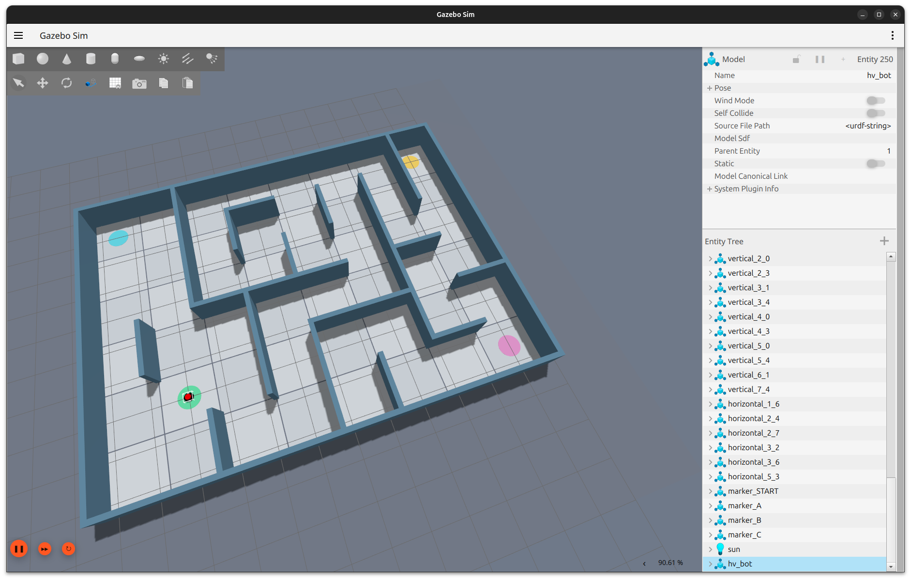
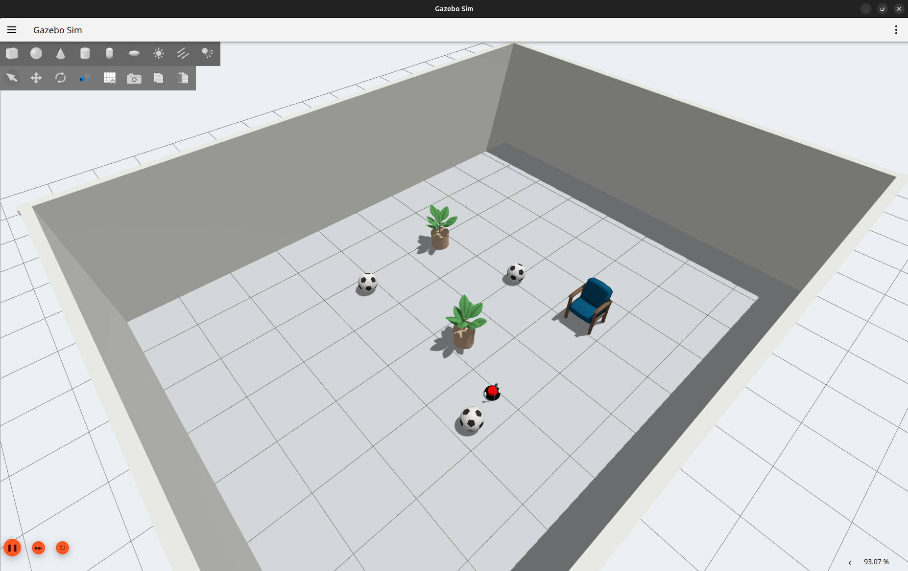
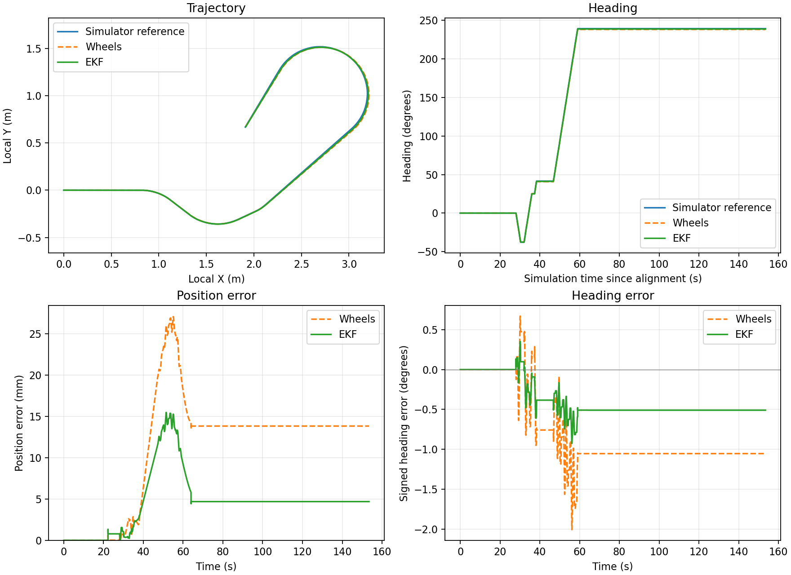
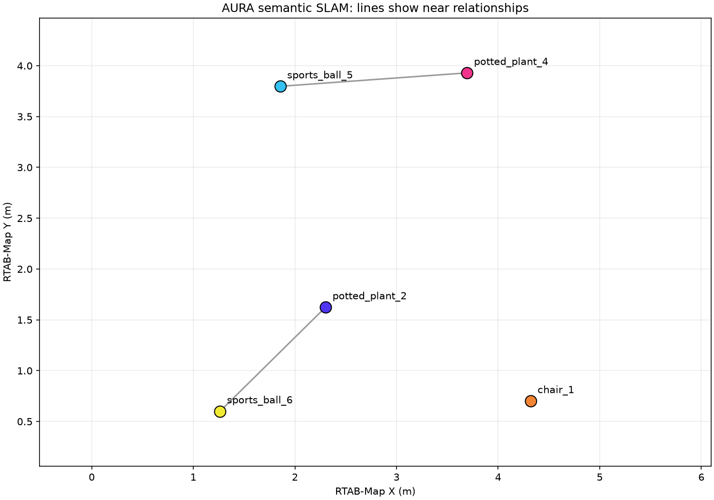

# AURA: ROS 2 Planning, Sensor Fusion and Semantic SLAM

A differential-drive robot simulation demonstrating three connected areas of
robotics: custom global path planning, wheel/gyro state estimation, and static
object mapping with a scene graph.

| Demonstration | Environment | Main components |
|---|---|---|
| Custom path planning | Maze | C++ A* planner plugin, Nav2, AMCL and Regulated Pure Pursuit |
| Odometry comparison | Six-object room | C++ Eigen EKF, wheel velocities, IMU gyro and simulator reference |
| Semantic RGB-D SLAM | Six-object room | RTAB-Map, YOLO11 instance segmentation and keyframe-anchored object observations |

## Environments

### Maze



The maze demonstration uses a saved occupancy map and AMCL localisation.
`aura_navigation::AStarPlanner` computes the global path; Nav2's Regulated
Pure Pursuit controller follows it. This is a known-map planning demonstration.

[Watch the maze planning video](https://github.com/Harivathsha/AURA-ROS2/releases/download/demo-v1/maze_planning.mp4)

### Six-object room



The spacious test room contains three patterned balls, two potted plants and
one chair. This same room is used for the EKF and semantic mapping recordings.

## Wheel and gyro fusion



The planar EKF estimates motion from wheel velocities and IMU angular velocity.
The four panels show trajectory, heading, position error and heading error.
The recorder aligns the simulator reference to the estimator's initial local
frame and compares measurements at matching times. The reference is used for
evaluation; it is not supplied as a measurement to the EKF.

[Watch the EKF fusion video](https://github.com/Harivathsha/AURA-ROS2/releases/download/demo-v1/ekf_fusion.mp4)

## Semantic mapping and scene graph



YOLO11 supplies object classes and instance masks. Registered depth provides
the measured surface geometry. Observations are retained relative to RTAB-Map
keyframes and reprojected when optimized poses change. Object association uses
position, visible bounds and surface support; repeated observations confirm
an object ID. The scene graph records geometric relationships such as near,
left_of and in_front_of in fixed map coordinates.

The ordinary RTAB-Map cloud uses camera colours. The semantic cloud colours
objects by identity. The scene graph image is a top-down projection; its lines
show near relationships.

[Watch the semantic SLAM video](https://github.com/Harivathsha/AURA-ROS2/releases/download/demo-v1/semantic_slam.mp4)

## Recorded results

<!-- RESULTS_START -->
Recorded EKF run: **153.46 s, 7674 aligned samples**.

| Estimate | Position RMSE | Heading RMSE |
|---|---:|---:|
| Wheel only | 0.0132 m | 0.912° |
| Wheel + gyro EKF | 0.0057 m | 0.445° |

These values describe one recorded simulation run.

| Class | Room count | Confirmed graph count |
|---|---:|---:|
| sports ball | 3 | 2 |
| potted plant | 2 | 2 |
| chair | 1 | 1 |

Object counts are predictions, not forced to match the room. Read the known limitations below.
<!-- RESULTS_END -->

Detailed outputs are under `results/ekf/` and `results/semantic/`:

- EKF: raw odometry, aligned comparison, metrics JSON and the four-panel PNG.
- Semantic mapping: coloured PLY surfaces, graph JSON/PNG and anchored object
  observations in NPZ format.

## Build and run

Target environment: Ubuntu 24.04, ROS 2 Jazzy and Gazebo Harmonic.

Build all five packages:

```bash
source /opt/ros/jazzy/setup.bash
colcon build --symlink-install --packages-select \
  description_new aura_navigation navigation aura_fusion aura_semantic_slam
source install/setup.bash
```

The original laptop workspace is `~/ai_envs/project/c++_project`. The semantic
launch defaults to `~/ai_envs/robotics_ai/bin/python` and to model/result paths
inside that workspace. For another machine, see [Setup](docs/SETUP.md).

Exact terminal order, recording commands, output collection and upload steps:
[Recording and upload guide](docs/RECORDING_AND_UPLOAD.md).

The existing trained model is `yolo11s-seg.pt`; no model training is performed
by this project. It can be downloaded from the project's demo release or from
Ultralytics using the setup instructions.

## Package layout

| Package | Role |
|---|---|
| `description_new` | Robot description, Gazebo bridges, maze and six-object worlds |
| `aura_navigation` | Custom C++ A* Nav2 global planner |
| `navigation` | Maze AMCL/Nav2 configuration, map and RViz display |
| `aura_fusion` | Eigen EKF, wheel baseline and live comparison recorder |
| `aura_semantic_slam` | RGB-D adapter, semantic observations, corrected object map and graph |

## Known limitations

- The pretrained model is used on rendered Gazebo imagery without fine-tuning.
  Missed objects and false labels remain possible.
- Three repeated detections confirm an ID; this does not establish that the
  predicted class is physically correct.
- Similar nearby objects and changing visible surfaces can cause association
  mistakes. The object count is not constrained to six.
- Object positions and bounds describe observed surfaces, not complete CAD
  geometry. The mapper is intended for static objects.
- A clean map does not by itself demonstrate an accepted loop closure. Positive
  RTAB-Map loop-closure reports should be checked separately.
- The semantic mapper retains a bounded observation history (600 processed
  frames by default). New launches start fresh semantic maps.

## Software and assets

This project integrates ROS 2, Gazebo, Nav2, Eigen, RTAB-Map and Ultralytics YOLO.
Existing package license declarations and asset notices are retained.
The textured chair is an OpenRobotics asset; see
[Third-party notices](THIRD_PARTY_NOTICES.md) and its included attribution file.
